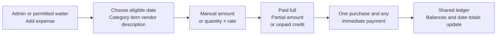
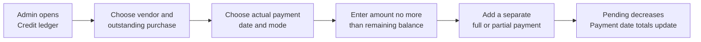
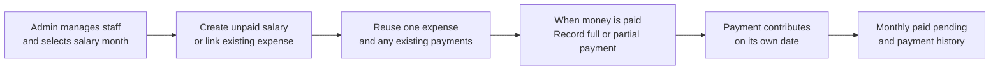
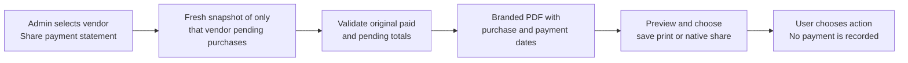

# Topolina functionality flows

Editable diagram sources for release 1.0.0. The PDF flow map also covers access, administration, dates, corrections and restore.

## Shared expense entry

## Vendor credit payment

## Staff and salary payment

## Vendor payment statement

